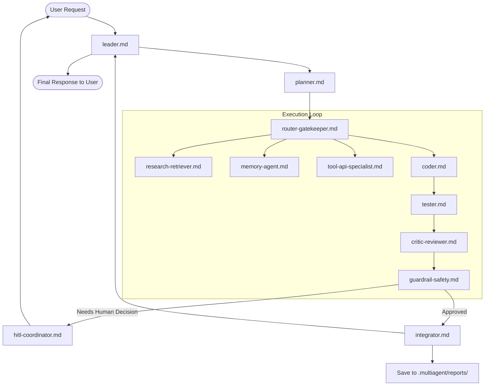

# Multi-Agent Team Coordination Skill

## 1. Overview
Skill này thiết lập quy chuẩn và cơ chế phối hợp giữa các chuyên gia agent trong nhóm (Multi-Agent Team) để giải quyết các bài toán kỹ thuật từ đầu đến cuối một cách tự động, có cấu trúc và đáng tin cậy.

## 2. Team Architecture & Agent Roster

Hệ thống bao gồm 12 vai trò agent chuyên biệt nằm trong `.agents/agents/`:

| Agent | File | Trách nhiệm chính |
|-------|------|-------------------|
| **Leader** | `leader.md` | Chỉ huy toàn cục, tiếp nhận yêu cầu và điều phối chu trình |
| **Planner** | `planner.md` | Phân rã mục tiêu thành kế hoạch thực thi từng bước (DAG) |
| **Router & Gatekeeper** | `router-gatekeeper.md` | Định tuyến tác vụ, kiểm duyệt payload và luồng dữ liệu |
| **Memory Agent** | `memory-agent.md` | Quản lý bộ nhớ ngắn/dài hạn tại `.multiagent/memory/` |
| **Research Retriever** | `research-retriever.md` | Khảo sát codebase, tra cứu tài liệu và best practices |
| **Tool & API Specialist** | `tool-api-specialist.md` | Tích hợp công cụ, CLI, MCP tools và xử lý API calls |
| **Coder** | `coder.md` | Viết mã nguồn chất lượng cao, tối ưu và chuẩn mực |
| **Tester** | `tester.md` | Viết và chạy test, thu thập bằng chứng kiểm thử thực tế |
| **Critic & Reviewer** | `critic-reviewer.md` | Đánh giá phản biện code, kiến trúc và UI/UX |
| **Guardrail & Safety** | `guardrail-safety.md` | Quét bảo mật, bảo vệ bí mật và ngăn ngừa thao tác rủi ro |
| **HITL Coordinator** | `hitl-coordinator.md` | Quản lý điểm tương tác người - máy (Human-in-the-loop) |
| **Integrator** | `integrator.md` | Hợp nhất kết quả, xuất báo cáo tại `.multiagent/reports/` |

## 3. Directory Layout & Persistence

```
.multiagent/
├── memory/      # Ghi nhận ngữ cảnh, conventions, bài học kinh nghiệm dài hạn
├── reports/     # Báo cáo tổng kết, đánh giá thay đổi và audit log
└── runs/        # Dấu vết thực thi, log phiên chạy của từng sub-task
```

## 4. Operational Workflow



## 5. Team Execution Principles
1. **Evidence Before Claims**: Bắt buộc có kết quả kiểm thử thực tế trước khi xác nhận hoàn thành bất kỳ task nào.
2. **Context Persistence**: Mọi thông tin quan trọng phải được ghi vào `.multiagent/memory/` để tránh thất lạc qua các phiên làm việc.
3. **Safety & Zero Trust**: Luôn rà soát an toàn và bảo mật trước khi thay đổi có hiệu lực.
4. **Modularity**: Mỗi agent tập trung vào chuyên môn của mình, giao tiếp qua định dạng rõ ràng và có cấu trúc.
