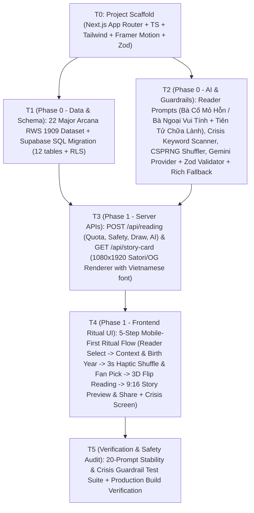

# Execution DAG — Phase 0 (Preparation) & Phase 1 (MVP)

## DAG Nodes

## Role Assignments
1. **Leader & Planner:** Orchestrate DAG, initialize Next.js workspace, manage integration.
2. **Data & Database Specialist (`coder` / Subagent A):** Build `src/data/tarot-cards.ts` (22 Major Arcana with RWS 1909 Wikimedia/public-domain URLs + bespoke SVG mystic card art fallback, bilingual names, upright/reversed keywords, topic-specific meanings) and `supabase/migrations/001_initial_schema.sql` (all 12 tables from PLAN.md v2 + RLS policies).
3. **AI, Safety & Prompt Specialist (`tool-api-specialist` & `guardrail-safety` / Subagent B):** Build `src/lib/safety.ts` (pre-AI crisis & age-tier classifier), `src/lib/shuffler.ts` (CSPRNG Fisher-Yates + 30% reversed), `src/lib/schemas.ts` (Zod schemas), `src/lib/prompts.ts` (2 Readers + Teen-Safe 10-15yo mode), and `src/lib/ai-provider.ts` (`@google/genai` integration + 2-retry Zod validation + rich context-aware fallback generator).
4. **API & 9:16 Story Card Specialist (`coder`):** Build `/api/reading/route.ts`, `/api/story-card/route.tsx` (`1080x1920` server-side `next/og` renderer with safe zones, QR code, quote switcher, privacy toggle), and rate-limit/quota tracker.
5. **Frontend Ritual Experience Specialist (`coder`):** Build the tactile mobile-first PWA experience in `src/app/` and `src/components/` following `design-taste-frontend` (Obsidian & Warm Antique Gold palette, Cormorant Garamond + Be Vietnam Pro, 3s haptic shuffle charge, interactive fan of 22 cards, 3D card flip reveal, 9:16 Story Studio modal, Crisis Support view, Legal/Privacy modal).
6. **Tester & Critic Reviewer (`tester` & `critic-reviewer`):** Run automated verification over 20 diverse test questions (including crisis triggers, prompt injection attempts, and 10–15yo kid-safe queries), verify TypeScript & Next.js production build, and write final audit report to `.multiagent/reports/phase0_1_report.md`.
