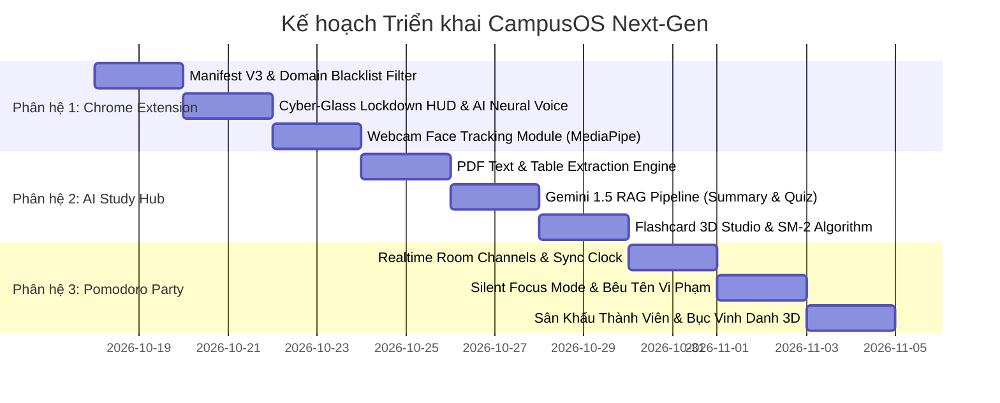

# CampusOS — Master Implementation Plan: Next-Gen Capabilities (v2.1)

> **Phiên bản:** 2.1.0 — Tích hợp đầy đủ phản hồi phỏng vấn kiến trúc chuyên sâu (/grill-me)  
> **Trạng thái:** Đã thống nhất & Sẵn sàng triển khai (Approved & Ready for Execution)  
> **Tác giả:** Antigravity Architect & Pair Programmer  

---

## 📑 Mục lục
1. [Tổng quan Kiến trúc Hệ sinh thái (Ecosystem Architecture)](#1-tổng-quan-kiến-trúc-hệ-sinh-thái)
2. [Phân hệ 1: Chrome Extension "AI Giám Sát Cực Đoan" (Tab Tracking + AI Webcam Face Tracking)](#2-phân-hệ-1-chrome-extension-ai-giám-sát-cực-đoan)
3. [Phân hệ 2: AI Study Hub "Bộ Tứ Toàn Năng" (PDF RAG, Quiz, Flashcard 3D, Q&A)](#3-phân-hệ-2-ai-study-hub-bộ-tứ-toàn-năng)
4. [Phân hệ 3: Đấu Trường Học Nhóm Realtime (Pomodoro Party Silent Focus)](#4-phân-hệ-3-đấu-trường-học-nhóm-realtime-pomodoro-party)
5. [Lộ trình Triển khai Đề xuất (Execution Roadmap)](#5-lộ-trình-triển-khai-đề-xuất)
6. [Hệ thống Kiểm định & Cổng Chất lượng (Quality Gates)](#6-hệ-thống-kiểm-định--cổng-chất-lượng)

---

## 1. Tổng quan Kiến trúc Hệ sinh thái

```mermaid
graph TB
    subgraph ClientApp ["Lớp Client & Thiết Bị"]
        WebApp["CampusOS Web App (Next.js 14 Cyber-Glass)"]
        Extension["Chrome Extension (Manifest V3 - Strict Supervisor)"]
        WebcamAI["AI Face Tracking Module (MediaPipe / Web Worker)"]
    end

    subgraph ServiceLayer ["Lớp Dịch Vụ & Động Cơ"]
        RealtimeBus["Supabase Realtime Channel (Presence & Broadcast)"]
        GeminiEngine["Gemini 1.5 Flash AI Engine (PDF RAG / Quiz / Flashcards)"]
        TTSModule["Multi-tier Resilient Neural TTS (Edge / Google)"]
        SyncEngine["Offline-First Sync Engine (Local Cache + Auto-flush)"]
    end

    subgraph CloudStorage ["Lớp Đám Mây Supabase Cloud"]
        PostgreSQL[(PostgreSQL + 19 Bảng + RLS)]
        Storage[(Buckets: academic-materials, task-attachments, student-avatars)]
        Auth[Supabase Auth (auth.users)]
    end

    WebApp <-->|externally_connectable / BroadcastChannel| Extension
    Extension <--> WebcamAI
    WebApp <--> SyncEngine
    SyncEngine <--> RealtimeBus
    RealtimeBus <--> PostgreSQL
    WebApp <--> GeminiEngine
    GeminiEngine <--> Storage
    Extension --> TTSModule
    WebApp <--> Auth
```

---

## 2. Phân hệ 1: Chrome Extension "AI Giám Sát Cực Đoan"

### 2.1. Quyết định Kiến trúc & Thiết kế Đã Thống nhất
- **Cơ chế phát hiện kép (Dual-detection)**:
  1. **Theo dõi URL Tab trình duyệt**: Nhận diện tức thì (< 200ms) khi sinh viên chuyển sang các trang nằm trong Blacklist (`facebook.com`, `tiktok.com`, `youtube.com`, `shopee.vn`, `reddit.com`, `netflix.com`...).
  2. **Tùy chọn AI Webcam Face Tracking**: Người dùng có thể bật/tắt camera trong cài đặt Pomodoro; sử dụng mô hình nhẹ (MediaPipe Face Landmark) chạy hoàn toàn cục bộ trên máy để nhận diện khi sinh viên quay mặt đi quá 10 giây hoặc gục xuống bàn ngủ.
- **Cơ chế cưỡng chế nghiêm khắc có ân hạn**:
  - Làm mờ đen trang web vi phạm (`pointer-events: none; backdrop-filter: blur(25px)`).
  - Nhân vật giám sát (Mèo Cam Cutout / Tom 3D) phóng to màn hình, phát âm thanh mắng chửi bằng giọng Neural TTS.
  - Trừ ngay **-50 XP** đồng bộ về Supabase.
  - Bắt đầu thanh đếm ngược **5 giây** tự động cưỡng chế đóng tab vi phạm và chuyển tiêu điểm về CampusOS.
  - **Ân hạn hợp lý**: Cho phép sinh viên bấm nút *"Tôi đang tra tài liệu học"* (tối đa 1 lần / 3 phút mỗi phiên) để tạm ngưng cưỡng chế nếu cần tìm tài liệu nghiên cứu.

### 2.2. Chi tiết Triển khai File trong `extension/`
- `manifest.json`: Manifest V3, cấp quyền `tabs`, `declarativeNetRequest`, `storage`, `activeTab`, `scripting`, và `externally_connectable` trỏ tới `http://localhost:3000/*` và domain production.
- `background.js`: Service worker lưu trữ trạng thái phiên học, danh sách blacklist, nhận diện `tabs.onActivated` và `tabs.onUpdated`.
- `content.js`: Inject trực tiếp vào mọi trang web; dựng giao diện Cyber-Glass Lockout HUD, phát file âm thanh giọng nói, và xử lý đếm ngược đóng tab.
- `camera-tracker.js`: Web worker xử lý luồng video webcam bằng MediaPipe (Head Pose Estimation & Eye Aspect Ratio), tính toán điểm chú ý và gửi cảnh báo `DISTRACTED` hoặc `DROWSY`.
- `popup/index.html & popup/popup.js`: Giao diện Cyber-Glass nhỏ gọn trên thanh tiện ích, hiển thị đồng hồ Pomodoro đang chạy, nút chuyển nhanh về Web, và danh sách Blacklist tùy biến.

---

## 3. Phân hệ 2: AI Study Hub "Bộ Tứ Toàn Năng"

### 3.1. Quyết định Kiến trúc & Thiết kế Đã Thống nhất
Khi sinh viên tải lên một file slide bài giảng PDF môn học (`/study/courses/[id]`), hệ thống kích hoạt **Bộ tứ công cụ học tập thông minh**:

1. **Tóm tắt cốt lõi 5 phút (Executive Syllabus Summary)**:
   - Rút trích ngắn gọn các khái niệm quan trọng, công thức toán/lý/tin học, định lý và ví dụ mẫu.
   - Trình bày dạng Markdown Cyber-Glass có các Quantum Badges và bảng so sánh trực quan.
2. **Đề trắc nghiệm luyện thi thông minh (Practice Quiz Generator)**:
   - Tự động sinh 5-10 câu trắc nghiệm bám sát nội dung slide PDF.
   - Có phân loại độ khó (Dễ / Vận dụng / Nâng cao), gợi ý (Hint), giải thích chi tiết vì sao đúng/sai và chỉ ra số trang slide tương ứng để sinh viên xem lại.
3. **Thư viện Flashcard 3D Studio (Spaced Repetition SM-2)**:
   - Trích xuất bộ cặp thuật ngữ - định nghĩa (Term - Definition).
   - Render thẻ bài 3D bóng bẩy phong cách Cyber-Glass (Three.js), xoay lật 180 độ mượt mà khi nhấn phím Space.
   - Áp dụng thuật toán ghi nhớ ngắt quãng SM-2: Lưu lượt ôn tập, hệ số lặp (Ease Factor), tự động xếp lịch nhắc học vào các ngày tiếp theo.
4. **Chatbot hỏi đáp trực tiếp trên tài liệu (PDF RAG Q&A)**:
   - Cho phép sinh viên gõ câu hỏi thắc mắc về bất kỳ phần nào trong slide bài giảng và nhận câu trả lời tức thì từ Coach AI dựa trên đúng ngữ cảnh tài liệu.
- **Mô hình AI & Nhà cung cấp**:
  - Mặc định tích hợp sẵn **Google Gemini 1.5 Flash** (xử lý context lên tới 1 triệu tokens, đọc PDF siêu nhanh, tiếng Việt xuất sắc).
  - Hỗ trợ giao diện trong **Cài đặt (`/settings`)** cho phép sinh viên tự điền API Key riêng của mình (Gemini hoặc OpenAI) nếu muốn tùy chỉnh mô hình nâng cao.

### 3.2. CSDL Bổ sung cho Phân hệ 2
```sql
-- Lưu trữ bài trắc nghiệm sinh từ PDF
CREATE TABLE IF NOT EXISTS public.ai_generated_quizzes (
  id UUID PRIMARY KEY DEFAULT gen_random_uuid(),
  course_id UUID REFERENCES public.courses(id) ON DELETE CASCADE,
  chapter_id TEXT NOT NULL,
  title TEXT NOT NULL,
  source_file_url TEXT NOT NULL,
  questions JSONB NOT NULL DEFAULT '[]'::jsonb,
  created_at TIMESTAMPTZ NOT NULL DEFAULT NOW()
);

-- Lưu trữ bộ Flashcards môn học kèm thuật toán SM-2
CREATE TABLE IF NOT EXISTS public.course_flashcards (
  id UUID PRIMARY KEY DEFAULT gen_random_uuid(),
  course_id UUID REFERENCES public.courses(id) ON DELETE CASCADE,
  chapter_id TEXT NOT NULL,
  front_term TEXT NOT NULL,
  back_definition TEXT NOT NULL,
  difficulty INT NOT NULL DEFAULT 1,
  interval_days INT NOT NULL DEFAULT 1,
  repetitions INT NOT NULL DEFAULT 0,
  ease_factor NUMERIC(3,2) NOT NULL DEFAULT 2.50,
  next_review_at TIMESTAMPTZ NOT NULL DEFAULT NOW(),
  created_at TIMESTAMPTZ NOT NULL DEFAULT NOW()
);
```

---

## 4. Phân hệ 3: Đấu Trường Học Nhóm Realtime (Pomodoro Party)

### 4.1. Quyết định Kiến trúc & Thiết kế Đã Thống nhất
- **Đa dạng 3 hình thức phòng học**:
  1. **Phòng công khai theo Môn học**: Ví dụ: Phòng *"Ôn thi Mạng máy tính"*, *"Luyện code CTDL & GT"* — sinh viên toàn trường có thể tham gia học cùng nhau.
  2. **Phòng riêng tư theo Mã PIN 6 ký tự**: Dành cho nhóm bạn thân học kín.
  3. **Phòng học tích hợp sẵn trong từng Nhóm Đồ Án (Workspace)**: Mỗi Workspace đồ án có 1 phòng focus riêng để cả nhóm cùng chạy deadline.
- **Kỷ luật & Tương tác "Silent Focus"**:
  - **Trong giờ học (45-50 phút)**: Tắt khung chat văn bản để tránh buôn chuyện phân tâm; chỉ cho phép gửi các **hiệu ứng hạt Reaction** (🔥, 👏, ❤️, "Cố lên! 💪") bay bổng nhẹ nhàng trên màn hình.
  - **Trong giờ giải lao (5-10 phút)**: Tự động mở chat nhóm, chia sẻ ghi chú và động viên nhau.
  - **Bêu tên kẻ bỏ cuộc**: Nếu thành viên nào trong phòng cố tình đổi tab lướt web giải trí hoặc thoát giữa chừng, **Avatar của người đó trên sân khấu ảo sẽ đổi sang viền đỏ nhấp nháy**, đồng thời Mèo Cam hiện thông báo cảnh cáo cho cả phòng: *"X đã bỏ cuộc và bị trừ -50 XP!"*.
- **Đồng hồ đếm ngược đồng bộ hoàn hảo**:
  - Sử dụng Supabase Realtime Channels (kết hợp NTP Server Timestamp Offset) đảm bảo độ lệch thời gian giữa các thành viên không quá 200ms.
- **Bục vinh danh 3D hàng tuần (Weekly Leaderboard Arena)**:
  - Bục 3D (Gold, Silver, Bronze) vinh danh 3 sinh viên có tổng số giờ focus cao nhất tuần, nhận huy hiệu danh dự Holographic.

### 4.2. CSDL Bổ sung cho Phân hệ 3
```sql
CREATE TABLE IF NOT EXISTS public.study_rooms (
  id UUID PRIMARY KEY DEFAULT gen_random_uuid(),
  code VARCHAR(8) UNIQUE NOT NULL,
  title TEXT NOT NULL,
  subject TEXT NOT NULL,
  host_id UUID REFERENCES public.profiles(id) ON DELETE CASCADE,
  focus_duration_minutes INT NOT NULL DEFAULT 45,
  is_active BOOLEAN NOT NULL DEFAULT true,
  current_status VARCHAR(20) NOT NULL DEFAULT 'waiting', -- 'waiting', 'focusing', 'break'
  created_at TIMESTAMPTZ NOT NULL DEFAULT NOW()
);

CREATE TABLE IF NOT EXISTS public.study_room_members (
  id UUID PRIMARY KEY DEFAULT gen_random_uuid(),
  room_id UUID REFERENCES public.study_rooms(id) ON DELETE CASCADE,
  user_id UUID REFERENCES public.profiles(id) ON DELETE CASCADE,
  status VARCHAR(20) NOT NULL DEFAULT 'focusing', -- 'focusing', 'distracted', 'break'
  joined_at TIMESTAMPTZ NOT NULL DEFAULT NOW(),
  total_minutes_contributed INT NOT NULL DEFAULT 0,
  UNIQUE(room_id, user_id)
);
```

---

## 5. Lộ trình Triển khai Đề xuất



---

## 6. Hệ thống Kiểm định & Cổng Chất lượng (Quality Gates)

Mỗi phân hệ khi triển khai bắt buộc phải vượt qua 100% các tiêu chuẩn:
- **`npm run typecheck`**: **0 lỗi** TypeScript trên toàn bộ codebase.
- **`npm test`**: Toàn bộ **380+ bài test hiện có PASS 100%** và bổ sung test suite mới cho từng phân hệ.
- **`npm run build`**: Biên dịch thành công 100% các routes tĩnh & động.
- **Git Commit**: Commit rõ ràng theo chuẩn Semantic và đẩy an toàn lên nhánh `main` repository GitHub.
