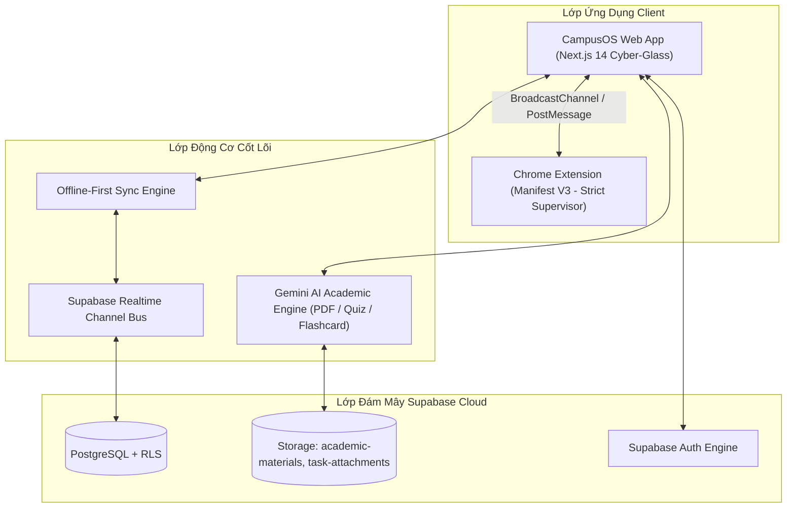
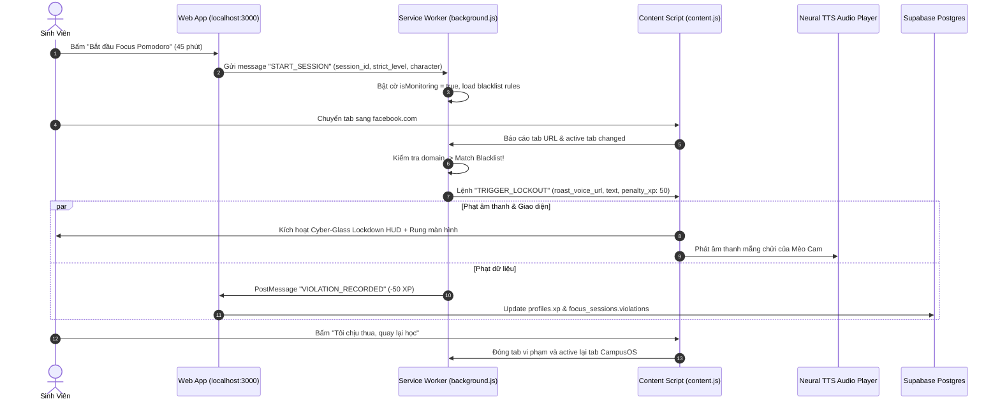
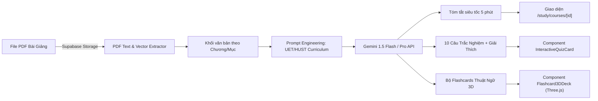
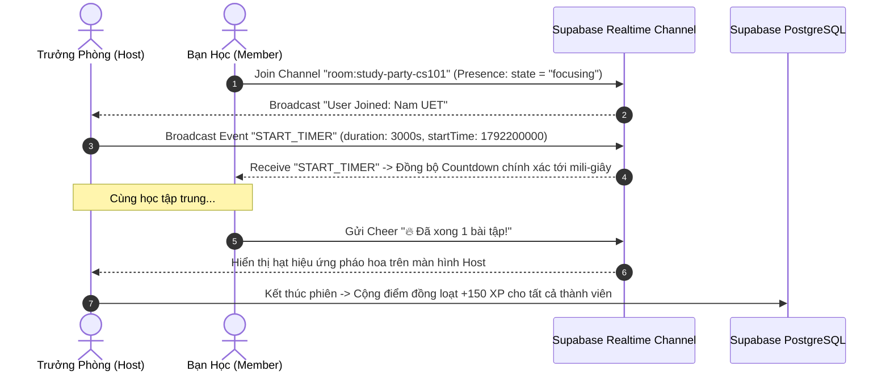
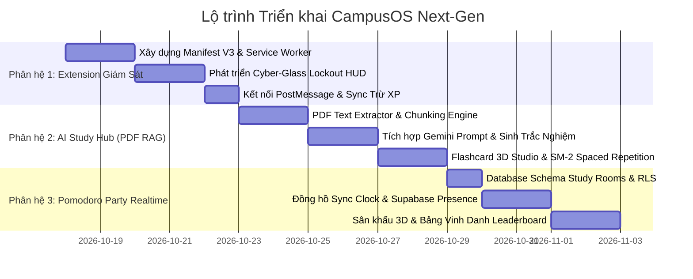

# CampusOS — Master Implementation Plan: Next-Gen Capabilities

> **Phiên bản:** 2.0.0 — Bản đặc tả kỹ thuật toàn diện cho 3 phân hệ chiến lược  
> **Trạng thái:** Chờ phê duyệt (Ready for Review)  
> **Tác giả:** Antigravity Architect & Pair Programmer  

---

## 📑 Mục lục
1. [Tổng quan Kiến trúc Hệ sinh thái (Ecosystem Architecture)](#1-tổng-quan-kiến-trúc-hệ-sinh-thái)
2. [Phân hệ 1: Chrome Extension "AI Giám Sát Học Tập Cực Đoan" (Tab Tracking & Lockout)](#2-phân-hệ-1-chrome-extension-ai-giám-sát-học-tập-cực-đoan)
3. [Phân hệ 2: AI Study Hub & Phân tích Slide Bài Giảng PDF (PDF RAG, Quiz & Flashcard 3D)](#3-phân-hệ-2-ai-study-hub--phân-tích-slide-bài-giảng-pdf)
4. [Phân hệ 3: Đấu Trường Học Nhóm Realtime (Pomodoro Party & Leaderboard Arena)](#4-phân-hệ-3-đấu-trường-học-nhóm-realtime-pomodoro-party)
5. [Lộ trình Triển khai Tổng thể & Phụ thuộc Kỹ thuật (Implementation Roadmap)](#5-lộ-trình-triển-khai-tổng-thể)
6. [Hệ thống Kiểm định & Cổng Chất lượng (Quality Gates)](#6-hệ-thống-kiểm-định--cổng-chất-lượng)

---

## 1. Tổng quan Kiến trúc Hệ sinh thái

Hệ thống CampusOS Next-Gen kết nối 3 phân hệ mới vào nền tảng cốt lõi (Next.js 14 Cyber-Glass + Supabase Cloud):



---

## 2. Phân hệ 1: Chrome Extension "AI Giám Sát Học Tập Cực Đoan"

### 2.1. Mục tiêu & Trải nghiệm Người dùng (UX)
Khi sinh viên kích hoạt phiên **Pomodoro Cực Đoan** trên Web App, Chrome Extension tự động chuyển sang chế độ **"Iron Cage" (Lồng Sắt)**:
- Nếu sinh viên mở tab hoặc lướt web trên các tên miền giải trí nằm trong blacklist (`facebook.com`, `tiktok.com`, `youtube.com`, `shopee.vn`, `reddit.com`, `netflix.com`, `bilibili.com`...):
  1. Toàn bộ trang web bị làm mờ tức thì (`backdrop-filter: blur(25px)` và lớp phủ đen đỏ Cyber-Glass).
  2. Nhân vật giám sát (Mèo Cam Cutout hoặc Talking Tom 3D) phóng to toàn màn hình, mắng chửi bằng giọng đọc AI Neural TTS theo độ gắt cấu hình (`light`, `medium`, `extreme`).
  3. Gửi tín hiệu WebSocket/PostMessage về Web App: **Trừ ngay -50 XP**, ghi nhận vi phạm vào `student_focus_sessions`, tăng chỉ số `violation_count`.
  4. Đếm ngược 5 giây cưỡng chế đóng tab hoặc chuyển hướng về `http://localhost:3000/tasks`.

### 2.2. Kiến trúc Kỹ thuật Extension (Manifest V3)



### 2.3. Cấu trúc File & Triển khai
- `extension/manifest.json`: Manifest V3, permissions: `tabs`, `declarativeNetRequest`, `storage`, `activeTab`, `scripting`, `notifications`.
- `extension/background.js`: Service worker quản lý trạng thái phiên học, kết nối hai chiều với Web App qua `chrome.runtime.onMessageExternal` (yêu cầu cấu hình `externally_connectable` trỏ tới `http://localhost:3000/*`).
- `extension/content.js`: Inject trực tiếp vào mọi tab trình duyệt; dựng Cyber-Glass DOM Modal với hình ảnh Mèo Cam và thanh đếm ngược phạt XP.
- `extension/popup/`: Giao diện Popup Extension hiển thị nhanh: Trạng thái phiên Pomodoro, Đồng hồ đếm ngược, Nút mở nhanh CampusOS, Toggle bật/tắt danh sách Blacklist tùy biến.

### 2.4. Tiêu chí Nghiệm thu Phân hệ 1
- [ ] Extension cài đặt trực tiếp qua chế độ Developer Mode của Chrome/Edge mà không phát sinh lỗi Manifest.
- [ ] Đồng bộ trạng thái tức thì giữa Web App và Extension: Web bắt đầu -> Extension bắt đầu; Web kết thúc -> Extension mở khóa.
- [ ] Chặn chính xác các trang giải trí khi đổi tab trong vòng dưới 200ms.
- [ ] Phạt XP chính xác và đồng bộ theo thời gian thực về Supabase Database.

---

## 3. Phân hệ 2: AI Study Hub & Phân tích Slide Bài Giảng PDF

### 3.1. Mục tiêu & Trải nghiệm Người dùng (UX)
Sinh viên đã có thể tải file PDF bài giảng lên từng tuần trong môn học (`/study/courses/[id]`). Phân hệ này bổ sung **Trợ lý AI Đọc hiểu Tài liệu**:
- **Tóm tắt 5 phút (Executive Syllabus Summary)**: Rút trích công thức cốt lõi, định lý, kiến thức trọng tâm của tuần học.
- **Tạo đề trắc nghiệm thông minh (Practice Quiz Generator)**: Tạo 5-10 câu trắc nghiệm bám sát nội dung slide với giải thích chi tiết đáp án đúng/sai.
- **Flashcard 3D Studio**: Tự động trích xuất các thuật ngữ (Term - Definition) thành bộ thẻ học 3D, hỗ trợ lật thẻ bằng hiệu ứng Three.js, ghi nhớ theo thuật toán ngắt quãng Spaced Repetition (SM-2).

### 3.2. Kiến trúc Trích xuất & Xử lý AI (RAG Pipeline)



### 3.3. Thiết kế CSDL Supabase (Bổ sung vào Schema)

```sql
-- Bảng lưu trữ bài tập trắc nghiệm tự động sinh từ PDF
CREATE TABLE IF NOT EXISTS public.ai_generated_quizzes (
  id UUID PRIMARY KEY DEFAULT gen_random_uuid(),
  course_id UUID REFERENCES public.courses(id) ON DELETE CASCADE,
  chapter_id TEXT NOT NULL,
  title TEXT NOT NULL,
  source_file_url TEXT NOT NULL,
  questions JSONB NOT NULL DEFAULT '[]'::jsonb, -- [{question, options, correct_index, explanation, hint}]
  created_at TIMESTAMPTZ NOT NULL DEFAULT NOW()
);

-- Bảng Flashcards môn học
CREATE TABLE IF NOT EXISTS public.course_flashcards (
  id UUID PRIMARY KEY DEFAULT gen_random_uuid(),
  course_id UUID REFERENCES public.courses(id) ON DELETE CASCADE,
  chapter_id TEXT NOT NULL,
  front_term TEXT NOT NULL,
  back_definition TEXT NOT NULL,
  difficulty INT NOT NULL DEFAULT 1, -- 1: Easy, 2: Medium, 3: Hard
  interval_days INT NOT NULL DEFAULT 1,
  repetitions INT NOT NULL DEFAULT 0,
  ease_factor NUMERIC(3,2) NOT NULL DEFAULT 2.50,
  next_review_at TIMESTAMPTZ NOT NULL DEFAULT NOW(),
  created_at TIMESTAMPTZ NOT NULL DEFAULT NOW()
);
```

### 3.4. Giao diện Người dùng (UI/UX)
- Bổ sung nút **"✨ AI Phân tích bài giảng"** cạnh mỗi file PDF đã tải lên trong `Course Detail`.
- Render **Flashcard 3D Deck**: Thẻ bài thủy tinh phát sáng Cyber-Glass, lật xoay 180 độ 3D khi click, phím tắt `Space` để lật, `1` (Khó), `2` (Bình thường), `3` (Dễ) để tính toán lượt ôn tiếp theo.

### 3.5. Tiêu chí Nghiệm thu Phân hệ 2
- [ ] Phân tích file PDF dung lượng tối đa 20MB (tương thích các định dạng slide bài giảng trường ĐH).
- [ ] Sinh đề trắc nghiệm có cấu trúc JSON hợp lệ 100%, không lỗi parse.
- [ ] Bộ Flashcard 3D chuyển động mượt mà 60-120FPS, không giật lag trên card đồ họa tích hợp.
- [ ] Lưu tiến độ ôn tập Flashcards chính xác vào bảng `course_flashcards`.

---

## 4. Phân hệ 3: Đấu Trường Học Nhóm Realtime (Pomodoro Party & Leaderboard)

### 4.1. Mục tiêu & Trải nghiệm Người dùng (UX)
Học một mình rất dễ bỏ cuộc. Phân hệ này biến việc học thành **Một phòng chơi Game hợp tác (Co-op Study Party)**:
- Sinh viên có thể tạo phòng học (`/pomodoro/party/[roomId]`) theo môn học hoặc nhóm đồ án.
- **Đồng hồ đếm ngược đồng bộ hoàn hảo (Sync Clock)**: Trưởng phòng bấm "Bắt đầu Focus 50 phút", tất cả thành viên trong phòng cùng đếm ngược đồng thời.
- **Sân khấu thành viên (Virtual Study Stage)**:
  - Avatar Holographic của mỗi thành viên hiển thị hiệu ứng ánh sáng (Xanh lá = Tập trung cao độ, Đỏ = Rời tab/Bị phạt, Vàng = Đạt Streak 5 phiên liên tiếp).
  - Cột năng lượng nhóm (Squad Energy Bar): Càng nhiều người tập trung, thanh năng lượng càng tăng, mở khóa nhân đôi XP (+100% XP Boost).
- **Phản ứng tương tác (Cheer Reactions)**: Bắn hiệu ứng vỗ tay, thả tim, "Cố lên!" bay bổng trên màn hình mà không làm gián đoạn việc học.
- **Bảng vàng vinh danh (Weekly Leaderboard Arena)**: Bục vinh danh 3D top 3 sinh viên có thời lượng học cao nhất tuần.

### 4.2. Kiến trúc Realtime WebSockets (Supabase Presence & Broadcast)



### 4.3. Thiết kế CSDL Supabase (Bổ sung vào Schema)

```sql
CREATE TABLE IF NOT EXISTS public.study_rooms (
  id UUID PRIMARY KEY DEFAULT gen_random_uuid(),
  code VARCHAR(8) UNIQUE NOT NULL,
  title TEXT NOT NULL,
  subject TEXT NOT NULL,
  host_id UUID REFERENCES public.profiles(id) ON DELETE CASCADE,
  focus_duration_minutes INT NOT NULL DEFAULT 45,
  is_active BOOLEAN NOT NULL DEFAULT true,
  current_status VARCHAR(20) NOT NULL DEFAULT 'waiting', -- 'waiting', 'focusing', 'break'
  created_at TIMESTAMPTZ NOT NULL DEFAULT NOW()
);

CREATE TABLE IF NOT EXISTS public.study_room_members (
  id UUID PRIMARY KEY DEFAULT gen_random_uuid(),
  room_id UUID REFERENCES public.study_rooms(id) ON DELETE CASCADE,
  user_id UUID REFERENCES public.profiles(id) ON DELETE CASCADE,
  status VARCHAR(20) NOT NULL DEFAULT 'focusing',
  joined_at TIMESTAMPTZ NOT NULL DEFAULT NOW(),
  total_minutes_contributed INT NOT NULL DEFAULT 0,
  UNIQUE(room_id, user_id)
);
```

### 4.4. Tiêu chí Nghiệm thu Phân hệ 3
- [ ] Độ lệch đồng hồ đếm ngược giữa các máy tính khác nhau không vượt quá 500ms.
- [ ] Cập nhật trạng thái thành viên vào/ra (Presence) tức thời không cần tải lại trang.
- [ ] Âm thanh và hiệu ứng tương tác vui tươi, tạo động lực nhưng không gây phân tâm.

---

## 5. Lộ trình Triển khai Tổng thể



---

## 6. Hệ thống Kiểm định & Cổng Chất lượng (Quality Gates)

Mỗi phân hệ khi triển khai bắt buộc phải vượt qua 100% các tiêu chuẩn:

1. **Static Analysis & Type Integrity**:
   - `npm run typecheck` hoàn thành với **0 lỗi**.
   - Strict ESLint không chứa unescaped entities hay duplicate keys.
2. **Unit Test Coverage**:
   - Đảm bảo toàn bộ **380+ tests hiện có tiếp tục PASS 100%**.
   - Bổ sung ít nhất 15-20 test cases cho mỗi phân hệ mới (Extension messaging mock, PDF extraction mock, Realtime presence sync mock).
3. **Production Build & Hydration**:
   - `npm run build` biên dịch thành công toàn bộ static & dynamic routes.
   - Không xuất hiện lỗi chớp giao diện (FOUC) hay hydration mismatch giữa server và client.
4. **Git Versioning**:
   - Mỗi mốc hoàn thành được commit kèm thông điệp Semantic rõ ràng và push an toàn lên nhánh `main` repository GitHub.
